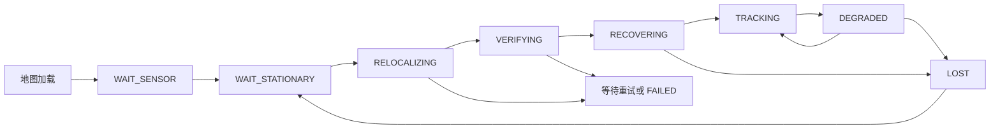

# SA-LIVO 接入 KISS-Matcher：ROS1 实施与运行说明

目标平台：Ubuntu 20.04、ROS1 Noetic、GCC 9、C++17。本文对应工作区中的实现，真实场景的精度、成功率及耗时目标仍需使用配套地图与传感器数据验收。

## 1. 功能与使用约定

已实现两个共用同一恢复入口的流程：

1. **启动重定位**：读取 PCD 和元信息，等待 LiDAR/IMU 静止数据，KISS-Matcher 全局粗配准，GICP 精配准，新扫描独立验证，然后初始化滤波状态。
2. **运行中恢复**：在实际滤波更新后检查定位质量，持续失效时停止有效位姿输出，等待停稳，重新搜索地图、验证并完整重置状态，观察通过后恢复输出。

本模式针对楼层、园区局部地图。设备须在启动及恢复阶段停稳。定位模块输出停车需求，不向底盘发送运动命令。原有建图 launch 继续用于制作地图；`localization.launch` 使用只读先验地图。

有效位姿的唯一判据是 `/localization/status.valid=true`。在启动、可疑、失效、匹配和恢复观察期间，不发布新的定位位姿和动态定位 TF。相机图像缺失时可以通过 LiDAR/IMU 定位；视觉恢复后重新建立观测窗口。

## 2. 构建与依赖

### 2.1 准备

在工作区根目录执行：

```bash
sudo apt-get install gcc-9 g++-9 cmake libeigen3-dev libopencv-dev libpcl-dev \
  libtbb-dev libflann-dev liblz4-dev libyaml-cpp-dev libboost-thread-dev libapr1-dev \
  ros-noetic-std-srvs ros-noetic-rostest

bash scripts/prepare_ros1_deps.sh
bash scripts/build_ros1.sh
```

现有 ROS、vikit、Sophus、Livox 依赖的说明见 `DEPENDENCIES_ROS1.md`。本机系统 Eigen 3.3.7 的配置路径是 `/usr/lib/cmake/eigen3`。

新增 `scripts/prepare_kiss_matcher_ros1.sh`：

- 本地构建 `src/kiss_matcher` 中的 ROBIN、PMC、xenium、KISS-Matcher 和 small_gicp。
- 产物安装至 `.deps/install`，不覆盖系统库。
- 固定 GCC 9，复用系统 Eigen 3.3.7、TBB 2020、FLANN 和 LZ4。
- 禁用第三方自动下载、测试、示例、Python绑定和 `-march=native`；small_gicp 使用 OpenMP。
- 构建前检查 `src/kiss_matcher/ROS1_SOURCES.sha256`。有意升级第三方代码时应审查变更并同步更新该清单。
- 补齐安装后的 CMake 传递依赖，使其他构建目录也能找到已安装目标。

第三方根目录带 `CATKIN_IGNORE`，因此其中普通 CMake 包不会被 catkin 当作 ROS 包扫描。

新增 `scripts/prepare_livox_ros1.sh` 用于源码缺失时下载固定提交 `21445540f0d100dc86a7e6df312dd70bbdb4afdf`，校验压缩包 SHA256，并保留 ROS1 构建入口。已有完整源码目录不会被覆盖。首次下载需要网络；归档缓存位于 `.deps/src`。

### 2.2 测试和安装

```bash
source /opt/ros/noetic/setup.bash
source devel/setup.bash
ctest --test-dir build/sa_livo --output-on-failure
bash scripts/build_ros1.sh install
```

完整测试会创建临时 ROS master、节点、地图和 bag，并使用本机回环网络。无需硬件、外部地图或现有走廊 bag。

## 3. 地图准备

### 3.1 地图文件

PCD 必须包含浮点 `x/y/z`，可以附带 intensity 或 RGB。XYZ 支持 FLOAT32/FLOAT64，非有限点会被过滤。空地图、点数不足、字段错误或元信息不匹配会导致初始化失败。

建图时启用原有 `pcd_save/pcd_save_en`。新导出的 PCD 旁会保存同名 `.yaml`，例如：

```text
scene_all_downsampled_points.pcd
scene_all_downsampled_points.pcd.yaml
```

建议优先使用降采样地图。无图像建图也支持原始 XYZI PCD。分段导出同样写入元信息。

### 3.2 元信息

```yaml
units: m
frame_id: map
version: building-floor1-v1
calibration_id: robot-a-2026-10
gravity: [0.0, 0.0, -9.81]
```

- `gravity` 必须是 **PCD 实际坐标系下** 的重力向量，新导出流程会从滤波状态保存实际值。
- 原建图参数默认关闭重力对齐，因此旧地图不能直接假定重力沿负 Z 轴。
- `calibration_id` 应标识实际传感器标定，并与运行参数一致。建图时可在传感器 YAML 中设置 `localization/calibration_id`。
- `frame_id=map` 是对保存坐标的命名，不会对 PCD 数值执行额外旋转。
- 旧地图需补齐可信元信息，或者使用对应数据重新建图导出。`config/map_metadata.example.yaml` 仅为格式示例。

地图通过独立接口直接从世界坐标构建平面统计。PCD 没有逐点协方差时采用 `map_sigma² I`，默认 `map_sigma=0.05 m`。

定位地图在加载后保持只读：实时点云插入和地图滑动都有统一保护，重置仅清除当前关联缓存。视觉仍可以用当前观测维护临时窗口。

## 4. 启动与接口

### 4.1 实机

```bash
source /opt/ros/noetic/setup.bash
source devel/setup.bash
roslaunch sa_livo localization.launch \
  map_path:=/absolute/path/scene.pcd \
  calibration_id:=robot-a-2026-10 \
  sensor_params_file:=/absolute/path/sensors.yaml \
  camera_params_file:=/absolute/path/camera.yaml
```

元信息默认读取 `<map_path>.yaml`，也可以通过 `metadata_path:=...` 指定。`sensor_params_file` 中的话题、雷达类型和外参必须对应当前设备；仅修改话题名不足以完成传感器适配。

### 4.2 回放

进程内读取 ROS1 bag：

```bash
roslaunch sa_livo localization.launch \
  map_path:=/absolute/path/scene.pcd \
  calibration_id:=robot-a-2026-10 \
  sensor_params_file:=/absolute/path/sensors.yaml \
  direct_bag_path:=/absolute/path/query.bag
```

外部回放，在两个终端分别执行：

```bash
roslaunch sa_livo localization.launch \
  map_path:=/absolute/path/scene.pcd \
  calibration_id:=robot-a-2026-10 \
  sensor_params_file:=/absolute/path/sensors.yaml \
  use_sim_time:=true
```

```bash
rosbag play /absolute/path/query.bag --clock
```

bag 应包含启动静止片段。进程内读取会在全局匹配期间暂停继续读取，并对传感器队列施加背压。实时订阅使用有界队列；队列溢出会使原有积分连续性失效，进入重新定位流程。

外部回放使用仿真时钟判断数据新鲜度，暂停 `/clock` 不计为断流。时钟或消息时间回退会清除旧任务和同步历史。

### 4.3 ROS 接口

| 接口 | 类型/行为 |
|---|---|
| `/localization/status` | `sa_livo/LocalizationStatus`，锁存状态；含有效性、停车需求、原因、任务编号、地图版本和跟踪质量 |
| `/localization/pose` | `geometry_msgs/PoseWithCovarianceStamped`，地图坐标下的 IMU 位姿及协方差，仅 TRACKING 发布 |
| `/localization/prior_map` | 锁存 `sensor_msgs/PointCloud2`，供 RViz 检查 |
| `/localization/relocalize` | `std_srvs/Trigger`，受理手动重定位请求并重置重试次数 |
| `/aft_mapped_to_init` | 保留原话题；定位模式下使用地图坐标，遵循相同有效性门控 |

```bash
rostopic echo /localization/status
rosservice call /localization/relocalize '{}'
```

服务返回成功仅表示请求已受理。最终结果通过状态话题报告。连续失败达到上限后停留 `FAILED`，由该服务发起下一轮尝试。

RViz 的 Fixed Frame 设置为 `map`，显示 `/localization/prior_map`、`/cloud_registered` 和 `/path`。

### 4.4 坐标与协方差

定义 `T_A_B` 将 B 系点转换到 A 系。当前外参 `extR/extT` 是 `T_imu_lidar`：

```text
T_map_imu = T_map_lidar × inverse(T_imu_lidar)
```

定位模式使用 `map -> aft_mapped`，其中 `aft_mapped` 对应 IMU 状态。点云、轨迹、位姿及 IMU 高频传播输出使用一致的世界坐标。重定位允许地图位姿跳变；本版本不生成连续 `odom` 坐标系。

ROS 位姿协方差按 `[位置, 姿态]` 输出，内部按 `[姿态, 位置]` 排列；内部姿态切空间为机体坐标时，发布前转换到世界坐标。

## 5. 算法与恢复逻辑

### 5.1 状态机



传感器中断从当前流程进入 `WAIT_SENSOR`。地图初始化失败会报告错误并退出。

### 5.2 停稳、配准与独立验证

- 同时检查 IMU 均值/方差和短时点云相对运动，默认连续静止 `1 s`、不少于 `5` 帧。
- 多帧通过相对变换累积到参考 LiDAR 坐标。点云在 `20 m` 内采样，查询默认分辨率 `0.3 m`。
- 地图分块边长 `80 m`、步长 `40 m`。要求 `tile_size >= tile_stride + 2*query_radius`，确保查询范围覆盖。小地图可以是单块。
- 恢复时优先搜索最后可靠位置附近，随后完成其余搜索。未完成全部搜索或超过预算时不提交部分结果。
- 每个候选使用 KISS 粗配准和 small_gicp 精配准，再检查几何重叠、误差、重力方向和归一化信息矩阵。
- 同一子图中会屏蔽已找到的匹配区域再搜索其他假设，避免将同一个子图内的重复房间直接当作唯一解。假设过多无法完成唯一性检查时拒绝提交。
- 相同位姿的重叠子图候选合并；不同位置候选分数接近时判为歧义。
- 粗配准完成后还需两个未参与查询的新扫描复核，且两次结果满足位姿一致性约束。

KISS 的低对应点返回路径已修复：即使上一次成功，本次对应点不足也返回无效结果。封装仍逐次检查对应点、最终内点和变换合法性。

匹配由单个工作线程执行，仅接收地图和点云快照。主线程拥有滤波状态。超时取消是逻辑取消：旧结果不可提交，旧线程结束前不启动另一个线程，不强制中断 C++ 求解器。

### 5.3 默认门限

参数位于 `/laserMapping/localization`，模板见 `config/localization.yaml`。

| 参数 | 默认值 |
|---|---|
| KISS/精配准分辨率 | `0.30 / 0.15 m` |
| KISS 最终内点数 | `>=30` |
| 验证最近邻门限 | `0.5 m` |
| 验证重叠率 | `>=0.60`，分母为有效查询点数 |
| 验证欧氏 RMSE | `<=0.20 m` |
| 重力方向差 | `<=10°` |
| 两次验证位姿差 | `<=0.20 m / 3°` |
| 不同候选的歧义门限 | 重叠率差 `<0.05` 且 RMSE 差 `<0.05 m` |
| 匹配预算/重试间隔/上限 | `30 s / 5 s / 3 次` |
| 恢复观察 | `>=1 s` 且 `>=10` 次有效更新 |

这些是工程初值，需要使用目标设备和独立查询数据标定。信息矩阵先按查询点云特征尺度归一化，额外检查点到平面的几何可观测性；单一平面不能构成完整六自由度恢复依据。

### 5.4 跟踪质量

每次实际滤波更新记录一次质量，预处理事件不重复计数。记录门控前/后残差、匹配支持、视觉质量、位姿修正量、协方差及 SAIF 特征值。

- 匹配 `<30` 或比例 `<0.10` 视为 LiDAR 支持不足。
- 残差 RMS `>0.30 m`、有效视觉 `q<0.05`、求解失败或不确定性异常是其他异常信号。
- 至少两类异常持续 `0.5 s`，或完全没有有效观测持续 `0.3 s`，确认失效。
- LiDAR 支持不足持续 `2 s`，即使视觉仍可跟踪，也需要重新确认地图定位。
- 状态/协方差非有限或时间回退立即失效。
- 视觉单独变差、几何退化本身不单独触发重定位。

恢复观察要求匹配 `>=50`、比例 `>=0.20`、RMS `<=0.20 m`。观察期间的状态仅内部使用，通过后才输出有效定位。

### 5.5 完整重置

恢复使用独立新扫描的时刻提交，而不是将较早查询时刻的位姿直接赋给当前状态。恢复接口同步处理：

- 滤波状态、预测状态、地图管理器状态及高频 IMU 传播状态；
- 静止速度、陀螺零偏、可靠加速度零偏和地图重力；
- 对角重置协方差，清除旧交叉相关；
- IMU 边界样本、积分时间、历史姿态和跨帧点云；
- 两路视觉窗口、质量缓存、原视觉前端缓存、平面关联和退化计数；
- 平滑、BA、延迟着色历史及同步队列；
- 新轨迹分段，保留只读先验地图。

使用专用 `ImuProcess::resetForRelocalization()`，避免原 `Reset()` 的重新初始化覆盖匹配姿态。滤波器速度索引为 `7–9`，曝光量在索引 `6`；重置和已有速度初始化/ZUPT 均按正确索引访问。

默认重置标准差：姿态 `5°`、位置 `0.2 m`、曝光 `0.1`、速度 `0.1 m/s`、陀螺零偏 `0.01`、加速度零偏及重力 `0.1`。左右姿态扰动约定均有测试。

固定地图模式要求关闭修改历史轨迹的 `lio/lag_smooth`；启动配置已经设置为零。

## 6. 验收与交付

自动化测试包括：已知刚体变换配准、低重叠/平面退化/重复房间拒绝、零对应点旧结果清除、PCD 格式与元信息、持续和短暂失效、异步结果过期、重试上限、状态机 50 次恢复周期、非零外参、非 Z 轴重力、IMU 恢复后的传播及两种地图后端的只读约束。50 次周期使用替身全局求解器及真实点云验证，用于验证任务隔离和状态复用。

ROS 集成测试使用实际 mapper，分别覆盖无相机的进程内读取，以及带图像的外部 `rosbag play --clock`。数据由测试生成，每帧含无效点；注入跟踪失效后验证再次恢复、无效点过滤、有效位姿门控与输出坐标。

真实数据验收须使用同场景的独立建图/查询片段，目标为：

- 至少 20 个可辨识启动位置、20 次失效恢复；
- 位置误差 `<=0.30 m`、姿态误差 `<=3°`；
- 可辨识集合成功率 `>=95%`，负例和歧义集合不接受错误定位；
- 目标设备上记录耗时分布，完整匹配目标 `<=30 s`；
- 连续 50 次实际恢复无地图污染、旧结果覆盖及持续内存增长。

当前没有提供配套真实地图、标定及查询数据，以上真实数据指标不能由合成测试替代。执行记录见 `KISS_MATCHER_ROS1验证记录.md`。
