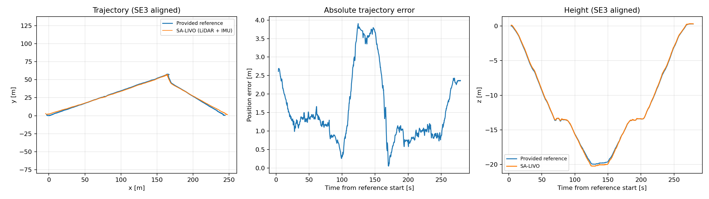

# Long Corridor：ROS1 无图像算法验证

验证日期：2026-10-20。目标环境为 Ubuntu 20.04、ROS1 Noetic、GCC 9、C++17。

## 结论

已完成指定原始 bag 的解码与全量 LiDAR/IMU 回放，实际使用 `common/img_en: 0`。
在增加 IMU 静止窗口初始化后，轨迹不再发散。相对同目录提供的参考轨迹，
全局刚体对齐、不拟合尺度时，位置 ATE RMSE 为 **1.857 m**，
1 秒平移 RPE RMSE 为 **0.131 m**，参考轨迹时间覆盖率为 **98.70%**。
仍有米级累计误差，不能据此宣称达到先前重定位方案中的 0.30 m 验收目标。

本次验证对象是 SA-LIVO 的 **LiDAR/IMU 里程计路径**。没有使用图像、已有 PCD 或
KISS-Matcher；本次结果不代表视觉融合或真实场景重定位恢复的验收结果。
参考 CSV 的精度、参考机体坐标与 IMU 坐标的标定关系尚未独立核实，因此这些数值是
相对所提供参考轨迹的误差。

## 数据核实与适配

原始文件：`Long_Corridor_Rosbag/raw_data_core_2023-07-25-03-01-44.bag`，
大小 6,473,379,689 字节，按原始记录时间持续约 280 秒。

| 原始话题 | 类型 | 消息数 | 本次处理 |
| --- | --- | ---: | --- |
| `/velodyne_packets` | `velodyne_msgs/VelodyneScan` | 2,777 | 解码为 `/velodyne_points` |
| `/imu/data` | `sensor_msgs/Imu` | 55,957 | 转存为 `/handsfree/imu` |
| `/camera_1/image_raw` | `sensor_msgs/Image` | 6,720 | 不读取、不参与算法 |

原 bag 实际含图像话题，但按要求全程禁用视觉。原 bag 没有 `/velodyne_points` 和
`/handsfree/imu`，因此仅修改订阅话题不能直接回放。

新增 `decode_velodyne_bag` 使用本机 ROS1 官方 `velodyne_pointcloud` 的 RawData 解码器及
`VLP16db.yaml`。逐包核对型号字节 `0x22`，输出 XYZ/intensity/ring/time，裁剪范围
2–150 m。共得到 **36,080,843** 个有效点；派生 bag 仅含点云和 IMU，使用 C++ LZ4 压缩，
约 681 MiB。原始 bag 未修改。

原记录时间是 2023 年，而传感器 header 和参考 CSV 时间属于 2018 年。派生 bag 使用
各消息 header 作为记录时间，保留传感器时间戳，便于进程内回放和 `rosbag play --clock`
使用同一时基。传感器时间范围为 `1517157219.088119`–`1517157499.161280`，约 280.073 s；
原始 LiDAR、IMU 各自的 header 均无回退。

## 参数迁移

配置文件：`src/sa_livo/config/long_corridor.yaml`。
所提供参数与本机 Super-LIO 的 `config/M2DGR.yaml` 一致；迁移其物理参数不等于证明
该标定适用于本次 Long Corridor bag。未利用参考轨迹搜索或拟合外参、时间偏移和噪声。

| 提供的设置 | SA-LIVO 配置 / 行为 |
| --- | --- |
| 无图像运行 | `common/img_en: 0`；专用 launch 再次强制设为 0 |
| `/velodyne_points`、`/handsfree/imu` | 使用派生 bag 的相应话题 |
| `lidar_type: 4` | 本工程为 `preprocess/lidar_type: 2`，即 VELO16；本工程 4 是 L515 |
| blind 2、maxrange 150、filter_rate 3 | `blind: 2.0`、`max_range: 150.0`、`point_filter_num: 3` |
| enable_downsample、voxel_fliter_size 0.5 | 点云体素下采样开启，`filter_size_surf: 0.5` |
| gravity_norm 9.7946 | 新增 `imu/gravity_norm: 9.7946`，初始化与 IMU 传播共用 |
| imu_na / imu_ng 0.1 | `imu/acc_cov`、`imu/gyr_cov` 均为 0.1 |
| imu_nba / imu_nbg 0.0001 | `imu/b_acc_cov`、`imu/b_gyr_cov` 均为 0.0001，现已实际读取 |
| lidar_imu 平移与单位旋转 | `extrinsic_T: [0.29, 0, 0.84]`，`extrinsic_R: I`，即 `T_imu_lidar` |
| odom_robo 全零、robot false | 输出 IMU 位姿，不另加机器人变换 |
| vox_resolution 0.5 | `lio/voxel_size: 0.5` |
| kf_max_iterations 4、kf_align_gravity true | `lio/max_iterations: 4`、`uav/gravity_align_en: true` |
| dense true、pub_step 5 | `publish/dense_map_en: true`、`pub_scan_num: 5` |
| save_map false、ds_size 0.3、save_interval 500 | 禁止保存 PCD；保留对应导出参数，关闭保存时不生效 |
| timer true | 新增 `evaluation/enabled: true`，保存逐次 LIO 更新的质量和耗时 |

Super-LIO 的 `hash_capacity`、`kf_type`、`kf_quit_eps` 没有可直接等价的 SA-LIVO 参数。
没有预分配一亿个哈希槽，也没有把其 KF 换成 SA-LIVO；保留本工程自适应平面地图、SAIF
更新和相应收敛阈值。两个实现都直接使用给定的 IMU 噪声数值构造协方差，未额外平方。
`map.if_filter: false` 描述地图导出，不会关闭已明确开启的当前扫描下采样。

## 必要代码修正与初始化对照

1. 标准 Velodyne `time` 单位为秒；内部 curvature 单位为毫秒。修正旧代码的除以 1000，
   改为乘以 1000；保留 `velodyne_time_scale` 参数供其他格式适配。
   本数据最大逐点偏移约 0.100839 s，与约 10 Hz 扫描相符。
2. 过滤非法 ring、非有限坐标、非法时间、近距离和超量程点，按时间排序，保证同步器
   使用的扫描结束时间正确。
3. 新增可配置重力模长和真正生效的 IMU 零偏噪声配置。
4. 离线读取对 LiDAR、IMU 分别施加有界队列背压，保留把待处理扫描补齐所需的后续 IMU。
5. 记录原有初始化失败的对照后，新增可选 IMU 静止初始化；其他配置默认关闭此选项。
   初始化样本缓存加互斥锁，初始化标志使用原子变量，避免读取线程与处理线程竞争。

此 bag 开始时正在运动：首秒平均角速度约 `[-0.011, 0.105, -0.472] rad/s`，
加速度模长标准差约 0.452 m/s²。原有前 30 条 IMU 初始化产生重力
`[-1.8793, 0.6187, -9.5927]`，该次轨迹随后发散。

最终配置等待至少 1 秒 IMU 稳定窗口：角速度模长不超过 0.05 rad/s、加速度向量标准差
不超过 0.10 m/s²、平均加速度模长与配置重力相差不超过 0.5 m/s²，并要求不少于 30 条样本。
这是重力初始化的 IMU 稳定条件，不是重定位模块的 IMU 与点云联合停车判定。

实际在 `1517157223.317919` 接受 202 条样本，距首个雷达时间约 **4.230 s**，初始重力为
`[-0.4751, -0.2291, -9.7804]`，随后对齐重力；速度置零，陀螺零偏使用稳定窗口均值。
启动等待期间不建图、不输出估计轨迹；仍读取了整个 bag。

| 项目 | 原有运动启动初始化 | 最终 IMU 稳定窗口初始化 |
| --- | ---: | ---: |
| 有效输出位姿 / LIO 更新数 | 2,774 | 2,735 |
| 位置 ATE RMSE | 34,172.191 m（发散） | **1.857 m** |
| 零匹配更新 | 1,780 | **1**（首个建图更新） |
| 轨迹长度 | 128,992.382 m | 585.336 m |

对照结果保存在 `validation/long_corridor/moving_start_baseline/`。上述对照只改变
初始化策略，没有根据参考轨迹更换外参、地图分辨率或滤波噪声。

## 最终评估结果

参考文件为 `Long_Corridor_Rosbag/ground_truth_path.csv`，共 1,385 个位姿，时间单位为纳秒。
使用短时间间隔内的平移插值和四元数 SLERP，不外推；对匹配位置做 SE(3) 最小二乘
刚体对齐，尺度固定为 1。1 秒 RPE 使用两条轨迹在对应时刻的相对位姿。

| 指标 | 测量值 |
| --- | ---: |
| 输出位姿数 / 关联参考位姿数 | 2,735 / 2,733 |
| 输出时间范围 | 1517157223.417869–1517157499.159283 |
| 参考时间覆盖率 | 98.7019%（启动等待不计入有效输出） |
| 参考轨迹长度 | 579.173 m |
| 估计轨迹长度 | 585.336 m |
| 平移 ATE RMSE / P95 / 最大值 | 1.857 / 3.685 / 3.904 m |
| 姿态 ATE RMSE | 2.207° |
| 1 秒平移 RPE RMSE | 0.131 m |
| 1 秒旋转 RPE RMSE | 1.356° |
| 非有限状态更新 | 0 |
| 有效匹配点数中位数 | 365 |
| 有限门控前残差 RMS 中位数 | 0.03225 m |
| LIO 计算耗时均值 / P95 / 最大值 | 5.081 / 14.606 / 29.384 ms |
| 整次 roslaunch 墙钟时间 | 20.22 s |
| 启动命令及子进程记录的最大 RSS | 333,204 KiB，约 325.4 MiB |

计算耗时只包含当前扫描下采样、匹配更新和体素地图写入，不包括解码、IMU 传播及
全部 ROS 发布开销。墙钟时间包含 ROS 启停和 bag 读取，不含预先解码和离线评估。
这些是本机一次运行的记录，不是受控性能基准；硬件信息见 `environment.json`。



## 构建与复现

工作区只保留 catkin 的 `build/`、`devel/`，未执行 install 构建；旧的工作区 `install/`
及额外的干净构建验证目录已经清理。`.deps/install/` 是第三方依赖，不是工作区 install
输出，仍用于已有 KISS-Matcher 库链接和运行。

```bash
cd /home/hyh/salivo
bash scripts/build_ros1.sh
bash scripts/validate_long_corridor.sh
```

验证脚本参数依次为：原始 bag、结果目录、参考 CSV、传感器参数 YAML；默认即为此次文件。
脚本自动解码、校验派生 bag 缓存身份、启动隔离端口的 ROS master、完整回放并生成评估结果。
需要本机 ROS 通信权限。派生 bag 已存在时复用；输入、标定或解码器改变时要求使用新结果目录。

需要观察 RViz 时，可使用已经解码的 bag：

```bash
source /opt/ros/noetic/setup.bash
source devel/setup.bash
roslaunch sa_livo mapping_long_corridor.launch use_rviz:=true use_sim_time:=true
# 另一终端，同样 source 环境后执行：
rosbag play --clock validation/long_corridor/decoded_lio.bag
```

专用 launch 默认使用 `long_corridor.yaml`，不会把 Livox Avia 的话题、雷达类型和外参
覆盖进这次运行。原 `avia.yaml` 保留 Avia 配置；本次运行由专用配置及 launch 保证 `img_en=0`。

## 检查与交付

- ROS1 build/devel 编译完成；没有生成工作区 install。
- 完整 CTest：6/6 通过，包含 Velodyne 时间单位、非法点、9.7946 重力传播、
  运动启动拒绝与后续稳定窗口接受，以及既有 KISS/状态重置/ROS1 恢复闭环测试。
- 评估器另用已知刚体变换及纳秒参考轨迹核验，位置 ATE 和 1 秒 RPE 小于 1e-6 m。
- `validation/long_corridor/regression_tests.txt` 保存回归结果。
- `validation/long_corridor/` 包含派生输入、参数快照、原始/对齐轨迹、逐帧质量 CSV、
  误差 CSV、`metrics.json`、运行日志、时间/内存记录及对比图。
- `inputs.sha256` 记录原 bag、参考 CSV 和本次参数快照校验；`input_identity.json`
  记录转换输入及解码器、Velodyne 标定文件身份。

如需继续验证固定地图启动重定位与搬动后恢复，仍需可信地图及同一传感器的真实标定，
并使用独立查询片段；此次无先验地图的里程计回放不替代该项验收。
